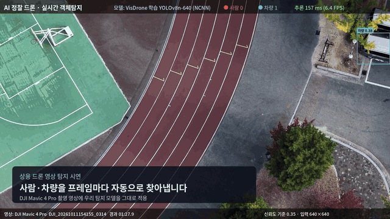
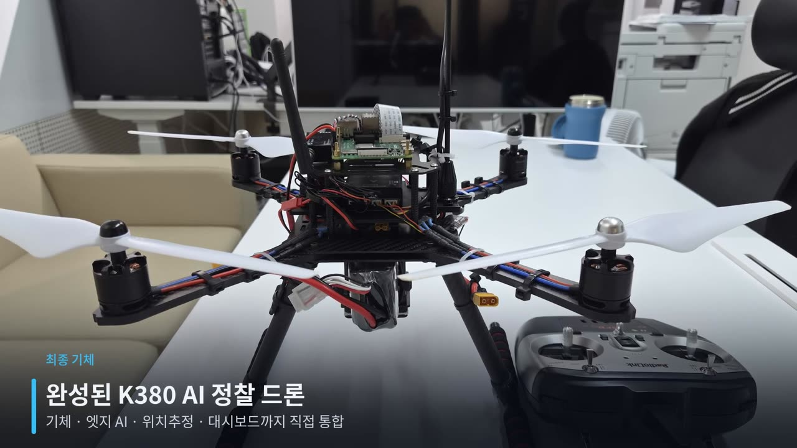
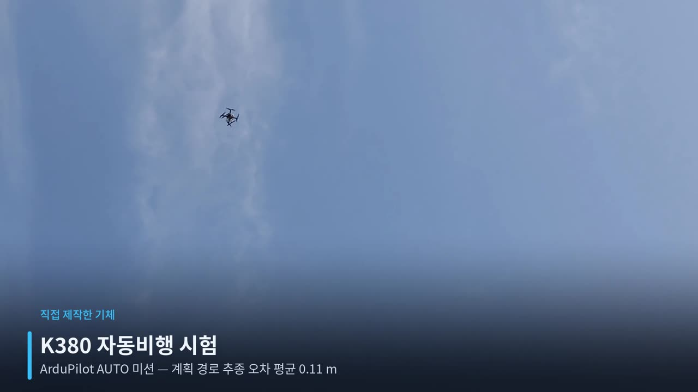
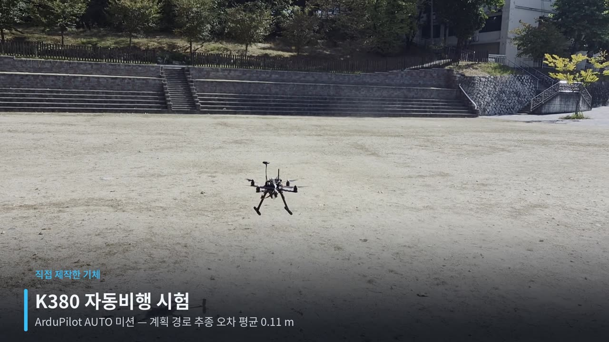
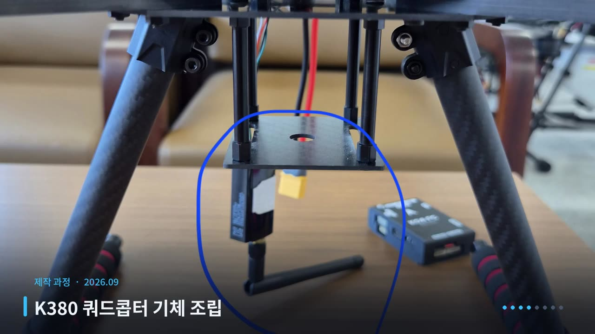
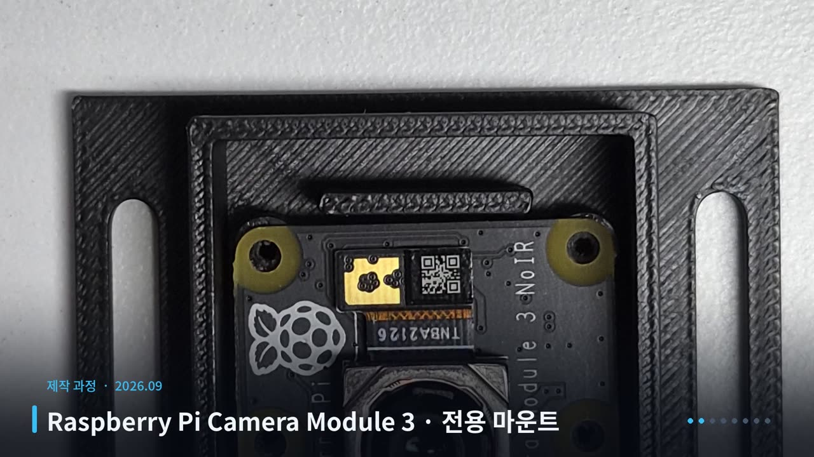
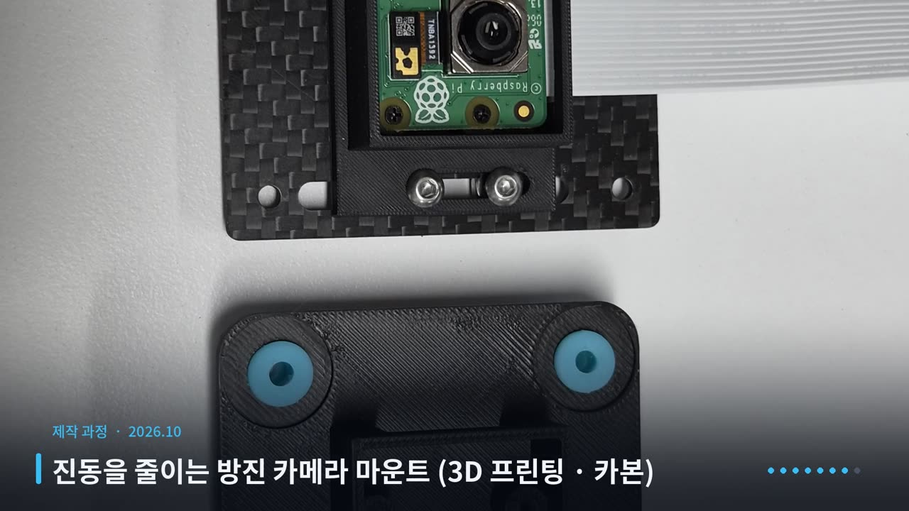
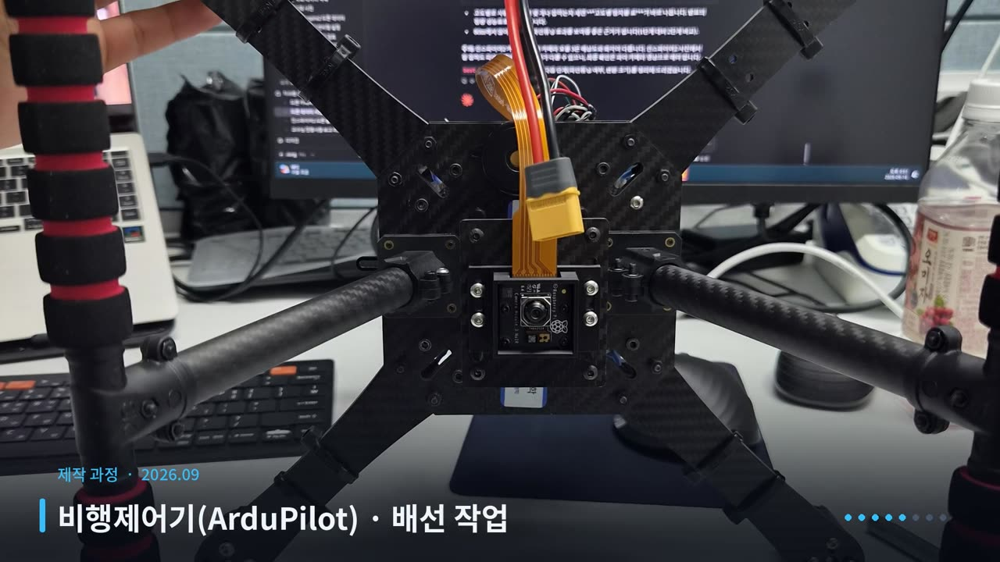
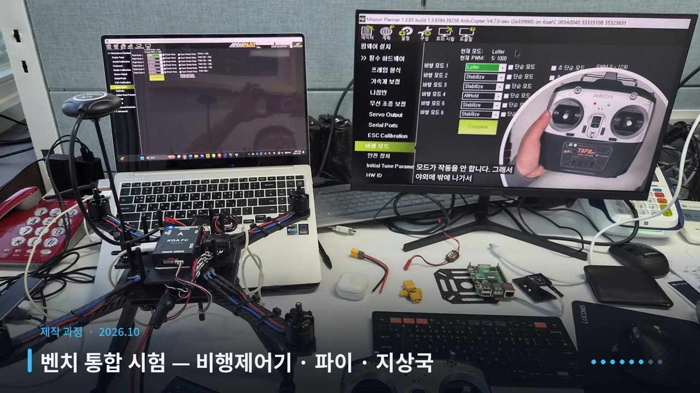

# K380 AI 정찰 드론 — 라즈베리파이 엣지 추론 기반 실시간 객체 탐지 및 지리 위치추정

**Real-Time Object Detection and Geolocation System for a Low-Cost Reconnaissance Drone Based on Raspberry Pi Edge Inference**



저가형 조립 쿼드콥터(K380)에 실은 **라즈베리파이 4**가 사람·차량을 실시간으로 탐지하고, 지상 노트북이 기체 자세(MAVLink)를 반영해 **탐지 대상의 실제 위도·경도를 지도에 표시**하는 정찰 드론 시스템입니다.

> 최종우, 지수환. "라즈베리파이 엣지 추론 기반 저비용 정찰 드론의 실시간 객체 탐지 및 지리 위치추정 시스템." *한국소프트웨어종합학술대회(KSC2026)*, 한국정보과학회, 2026.
> 강원대학교 디지털밀리터리학과

## 주요 결과 (논문 기준)

| 항목 | 결과 |
|---|---|
| 기체 추론 속도 (416×416, NCNN, Pi 4 CPU) | 5.92 fps (비행 중 전체 파이프라인 5.0 fps) |
| 비행 영상 사람 재현율 | COCO 모델 0~3.6% → **VisDrone 추가학습 모델 20.7~80.0%** |
| 위치추정 모의실험 평균 오차 | 자세 무시 40.28 m → **자세 보정 3.22 m** |
| 실비행 고정 물체 반복 추정 R50 | 자세 무시 2.39 m → **자세 보정 0.84 m** |

## 시스템 구성

```
[카메라 모듈 3] → [라즈베리파이 4] YOLOv8n(VisDrone, NCNN) 탐지
                        │  UART ── [KOAFC 비행제어기 / ArduPilot]
                        │  탐지 박스 + 프레임 시각 자세 (Wi-Fi / LTE)
                        ▼
              [지상 노트북] ground_station.py
                 · 카메라 광선 × 지면 교점으로 위경도 계산
                 · 객체 묶기, 감시구역 경보, 스냅샷, 보고서
                        ▼
              웹 대시보드 http://localhost:5000 (영상 · 지도 · 객체 목록)
```

| 구분 | 내용 |
|---|---|
| 기체 | K380 조립 쿼드콥터, KOAFC(ArduPilot), 433 MHz 텔레메트리 |
| 온보드 | Raspberry Pi 4, Raspberry Pi Camera Module 3, mavlink-router |
| 모델 | YOLOv8n — COCO 사전학습 → VisDrone 추가학습 → NCNN 변환 (416 / 640) |
| 지상국 | Python (aiohttp, pymavlink), Leaflet 지도 대시보드 |

## 기체 사진

| 완성된 K380 AI 정찰 드론 | 자동비행 시험 |
|---|---|
|  |  |
| **이륙 (ArduPilot AUTO 미션)** | **기체 조립** |
|  |  |
| **카메라 모듈 3 전용 마운트** | **방진 카메라 마운트 (3D 프린팅·카본)** |
|  |  |
| **비행제어기(ArduPilot) 배선** | **벤치 통합 시험 — 비행제어기·파이·지상국** |
|  |  |

## 폴더 구조

```
onboard/   라즈베리파이 탐지 노드 설정·자동 실행 스크립트
ground/    지상국 서버, 위치추정, 리플레이 분석, 보고서
ground/web 웹 대시보드 (HTML/JS/CSS, Leaflet)
models/    VisDrone 학습 YOLOv8n NCNN 모델 (best416_ncnn, best640_ncnn)
docs/      시연 GIF, 기체 사진(docs/images)
```

## 빠른 시작 — 하드웨어 없이 체험 (Windows/macOS/Linux)

```bash
cd ground
pip install -r requirements-ground.txt
python ground_station.py --sim-telem --sim-pi      # Windows는 run_sim.bat
```
브라우저에서 http://localhost:5000 을 열면 가짜 텔레메트리·탐지로 지도와 객체 목록이 채워집니다.

## 실제 운용

### 1) 라즈베리파이 4 (기체)
```bash
python3 -m venv --system-site-packages ~/visionenv   # picamera2 사용
source ~/visionenv/bin/activate
pip install -r onboard/requirements-pi.txt
# 모델 복사: models/best416_ncnn → ~/vision/models/best416_ncnn

python3 ~/pi/detector_node.py --model ~/vision/models/best416_ncnn --imgsz 416 --threads 3 \
    --mavlink udpin:127.0.0.1:14551
```
- 고고도(20~30 m) 정찰: `--model ~/vision/models/best640_ncnn --imgsz 640`
- 원본 영상 + 위치·자세 CSV 녹화: `--record ~/rec --record-armed`
- 부팅 시 자동 실행: `bash onboard/install_autostart.sh` (설정은 `onboard/detector.env`)

### 2) 지상 노트북
```bash
cd ground
python ground_station.py --com COM5 --baud 57600 --pi <파이 주소>      # 433MHz 텔레메트리 + 파이
python ground_station.py --pi <파이 주소> --telem-from-pi               # 텔레메트리도 파이 경유
```
- Mission Planner는 UDP 14550으로 동시 연결
- (선택) AI 정찰 보고서: 환경변수 `ANTHROPIC_API_KEY` 설정 시 Claude 보고서, 없으면 규칙 기반 보고서
- 실내 시험: `--bench-alt 10 --home-fallback --home <위도>,<경도>`

## 검증된 환경
- 라즈베리파이 4 (Raspberry Pi OS 64-bit), Python 3, ultralytics, NCNN
- 노트북: numpy 1.26.4 · opencv-python 4.10.0.84 · torch 2.8.0 CPU (torch 2.9 이상은 Windows에서 `c10.dll` 오류)

## 라이선스
[AGPL-3.0](LICENSE). 탐지 모델은 Ultralytics YOLOv8(AGPL-3.0)을 기반으로 학습했습니다.
사용한 공개 소프트웨어: [ArduPilot](https://ardupilot.org), [Ultralytics YOLOv8](https://github.com/ultralytics/ultralytics), [ncnn](https://github.com/Tencent/ncnn), [VisDrone](https://github.com/VisDrone/VisDrone-Dataset), [Leaflet](https://leafletjs.com).

## 지도교수 · 저자
- 지도교수: 지수환 (강원대학교 디지털밀리터리학과)
- 최종우 (Jongwoo Choi)
